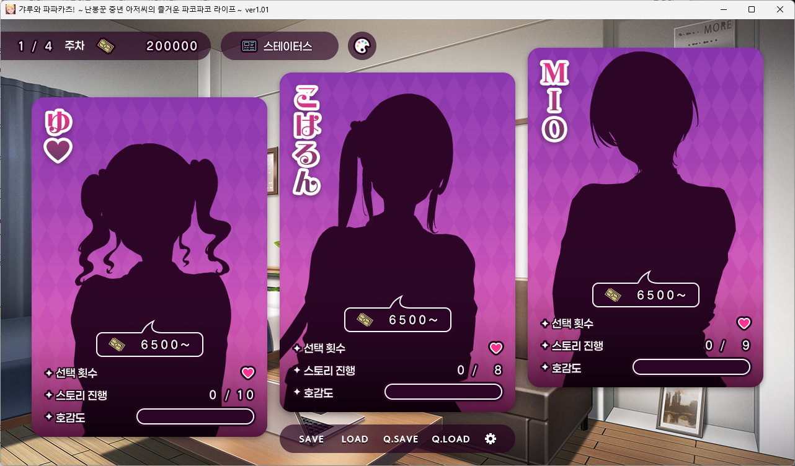
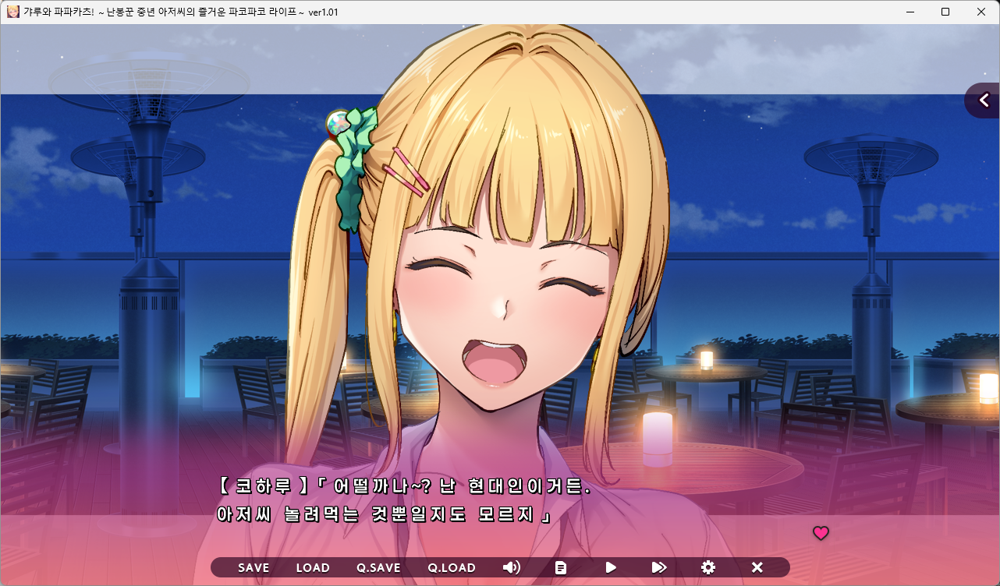

# 갸루와 파파카츠!(ギャルとパパ活！) 한글 패치

갸루와 파파카츠! 를 한글로 플레이할 수 있게 만든 패치입니다.
타이틀과 일부 이름 이미지는 미번역입니다.

**AI 번역: GEMINI 3.8 Flash 번역 / GPT 6 Astra 검수**

전체 CG 회수는 했지만 일부 번역이 부족한 부분이 있을 수 있습니다.

## 설치 방법

Windows 10/11 **64비트**, 원본 게임 **ver1.01**용입니다.

1. 게임과 런처를 종료합니다.
2. `GalPapaKoreanPatch-v버전.exe`를 `galpapa.exe`가 있는 게임 폴더에 넣고 실행합니다.
3. 진행률이 100%가 되면 생성된 `GalPapaLauncher.exe`로 게임을 실행합니다.

게임 폴더 쓰기 권한과 약 4GB의 여유 공간이 필요합니다.
`.galpapa_korean`의 원본·복구 백업은 유지하세요.
기존 `save/gsd.sd`가 있으면 파일 교체 전에 `.galpapa_korean/save_backups/날짜-시간/gsd.sd`로 백업하고 검증합니다. 백업에 실패하면 설치를 중단합니다. 슬롯 세이브는 수정하지 않습니다.

### 원본 파일 SHA-256

패치가 검사하는 **ver1.01 순정 파일**의 SHA-256입니다. 아래 값과 다르면 지원하는 원본으로 인정하지 않습니다.

| 원본 파일 | SHA-256 |
|---|---|
| `pac/ysbin.ypf` | `564069ed90bc9f7b0e6e83e590c1de84d49829625c072e33dc0ba1b010d02696` |
| `pac/update1.ypf` | `c77d8eda21db903ccbf6b194bb20eb181d64851d329dadbe1c8021ec4ff82945` |
| `pac/cgsys.ypf` | `d628ec149e04bc8b5ed2763aafa342d398caf1a5438ff20d9dade8e6de56a74e` |
| `pac/cg.ypf` | `ffcc7171fefa70d5433ae2cb89446687d7bab40f26872bc7254e62743e5106ea` |

`cgsys.ypf`와 `cg.ypf`는 패치 후 해시가 달라집니다. 재패치할 때는 `.galpapa_korean/originals/`에 보관된 순정 파일을 기준으로 검사합니다.

## 빌드 방법

1. `VERSION`에 버전을 `1.0.0` 형식으로 지정합니다.
2. `main`에 push하면 **Build Korean patch EXE**가 자동 실행됩니다. 필요하면 Actions에서 수동 실행할 수도 있습니다.
3. 빌드가 성공하면 GitHub Release에 `GalPapaKoreanPatch-v버전.exe` 한 파일이 자동 등록됩니다.

같은 버전은 릴리즈의 EXE를 갱신하며, 새 버전을 배포할 때는 `VERSION`을 올립니다. `v1.0.0`처럼 `VERSION`과 일치하는 태그를 push하거나 수동 실행해도 동일하게 빌드·배포합니다. 런처·주입기·한글 DLL은 C++ 소스에서 자동 빌드합니다. 원본 게임 데이터와 이전 빌드 결과는 필요하지 않습니다.

## 번역 수정 방법

- 대사: `translation/reviewd/messages_ko.jsonl`
- UI·선택지: `translation/reviewd/ui_literals_ko.jsonl`
- 휴대폰 이미지 대화: `translation/images/phone_ko.json`
- 공통 용어·승인된 음식명: `translation/glossary_v1.json`
- 나머지 이미지 문구·배치: `src/`의 이미지 생성 코드와 `src/image_specs.json`
- 엔드리스 H신 대사: `translation/reviewd/voice_text_ko.jsonl`
- 엔드리스 버튼·의상·게이지 이미지: `src/endless_images.py`의 문구와 렌더링 규칙

JSONL은 `target`만 수정하고 `source`, ID, 위치·검증 정보는 유지합니다. 휴대폰 이미지는 `text`의 줄바꿈을 유지합니다. 음식명은 용어집과 대사 번역을 함께 수정해 표기를 맞춥니다.

수정 후 GitHub Actions를 다시 실행합니다. 대사는 기본 720px·최대 3줄 기준으로 재배치되므로 긴 설명을 추가했다면 패치 후 실제 표시도 확인하세요.

## 라이선스

이 프로젝트는 [MIT 라이선스](LICENSE)로 공개합니다. **자유롭게 배포하고 수정할 수 있습니다.** 재배포 시 저작권 표시와 라이선스 고지를 유지해 주세요.

원본 게임·스크린샷의 게임 콘텐츠·포함된 폰트 및 제3자 자료에는 각각의 저작권과 라이선스가 적용됩니다.
